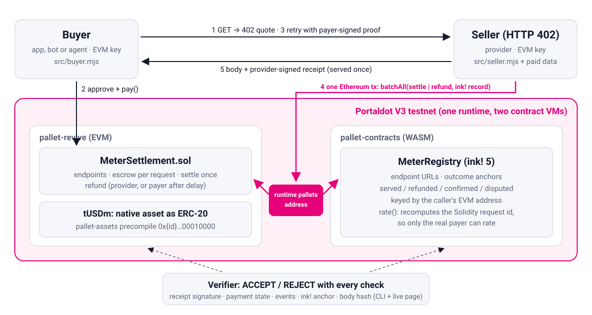

# Portal Meter

[](https://github.com/swiftbotlab/portal-meter/actions/workflows/ci.yml)

**Pay-per-request API settlement for Portaldot V3, running across both of its contract VMs.**

An API provider lists an endpoint with a price. A client pays for **one request** in a Portaldot native asset,
reached from Solidity through the runtime's ERC-20 precompile. The payment waits in escrow in a Solidity contract on
Portaldot's EVM. The provider serves the request once and settles it, or refunds it when it cannot deliver. In the
same Ethereum-signed transaction, the outcome is anchored in an **ink!** registry on Portaldot's WASM VM, which
gives every provider a public, per-request track record that buyers can check before they pay.

By Swift Bot Labs for the Portaldot Hacker House 2026, track **Modular Cloud & Middleware**.

**Live page:** [swiftbotlab.github.io/portal-meter/demo/](https://swiftbotlab.github.io/portal-meter/demo/) reads the
PortaldotV3 testnet from your browser (network, the native-asset ERC-20 precompile, contracts, endpoints, provider
record, payments) and includes a free receipt verifier.

**Demo video (2:42, voice-over and captions):** [YouTube](https://youtu.be/9YKFQafSMRo).
**Pitch deck:** [PDF](https://swiftbotlab.github.io/portal-meter/pitch/portal-meter-deck.pdf).

> **Live on the PortaldotV3 testnet since 2026-11-01:** both contracts, a real paid request and a real refund, each
> settled in Solidity and anchored in ink! in one Ethereum transaction. See [Testnet deployment](#testnet-deployment).

## How a request is paid



1. `GET /v1/asset/7777` → `402 Payment Required` with a quote: endpoint, price, token, a fresh nonce, the hash of
   this exact request.
2. The client checks the quote against the on-chain endpoint and the provider's record in the ink! registry, then
   calls `MeterSettlement.pay(endpointId, nonce, maxPrice)`. The contract derives the request id from the payer's
   address, so the payment can never be claimed by anyone else.
3. The client retries with a proof signed by the paying key. The seller checks it and the on-chain payment, and
   claims the request id: **served once**.
4. The seller sends one Ethereum transaction to Portaldot's runtime pallets address with
   `utility.batchAll([revive.call(settle), contracts.call(record)])`: the Solidity settlement and the ink! anchor
   happen together or not at all. If it cannot deliver, the same transaction shape refunds instead.
5. The client gets the body and a provider-signed receipt. Anyone can verify it: **ACCEPT / REJECT** with every
   check, on the command line or in the browser.

Details: [docs/ARCHITECTURE.md](docs/ARCHITECTURE.md) · [docs/PROTOCOL.md](docs/PROTOCOL.md) ·
[SECURITY.md](SECURITY.md) · measured network facts in [docs/PORTALDOT_V3_NOTES.md](docs/PORTALDOT_V3_NOTES.md).

## Why Portaldot

| Portaldot V3 feature | What Portal Meter does with it |
|---|---|
| Native assets exposed to Solidity as ERC-20 (pallet-assets precompile) | endpoints are priced in a native asset (`tUSDm`); no wrapped token contract |
| Two contract VMs in one runtime (pallet-revive EVM + pallet-contracts WASM) | escrow in Solidity, provider registry in ink!, both keyed by the same EVM address |
| Runtime calls from Ethereum transactions (`revive.ethSubstrateCall`) | settlement + registry anchor in one atomic transaction signed by the provider's Ethereum key; buyers rate providers in ink! from their Ethereum key |
| Storage deposits (pallet-revive / pallet-contracts) | payments clear their amount slot when final, so the deposit comes back |

The ink! registry recomputes the Solidity request id (`keccak256(abi.encode(chainId, settlement, payer, endpoint,
nonce))`) from the caller's own address. Only the account that paid on the EVM side can rate a request, and no
bridge or oracle is involved.

## Testnet deployment

PortaldotV3 testnet: EVM chain id `420420777`, `https://test-evm-rpc-v3.portaldot.dev`,
`wss://test-node-v3.portaldot.dev`, explorer [scanner-testnet-v3.portaldot.dev](https://scanner-testnet-v3.portaldot.dev).

| | Address | Deployed in |
|---|---|---|
| `MeterSettlement` (Solidity, pallet-revive) | `0x9E7Ad2Aa754A0EBA70CFbd1db01d25ef97e5781e` | [block 276611](https://scanner-testnet-v3.portaldot.dev/#/blocks/276611?tab=events), tx `0x1adf1c422c9782a22d974dea3d2abc0be287da435747883e7895375d15731227` |
| `MeterRegistry` (ink!, pallet-contracts) | [`5DHgN8JZRpyo9mDaG1BSNh224AZXcQw8p3Y8GZK1K2Vd8Ku4`](https://scanner-testnet-v3.portaldot.dev/#/accounts/5DHgN8JZRpyo9mDaG1BSNh224AZXcQw8p3Y8GZK1K2Vd8Ku4) | [block 276655](https://scanner-testnet-v3.portaldot.dev/#/blocks/276655?tab=events), extrinsic `0xef17ab339d696959449ed2e94bd066fb86de2a1945297d0d3d7dc35f97bd60e0` |
| Payment token: native asset [#43907 tUSDm](https://scanner-testnet-v3.portaldot.dev/#/assets/43907) (test token, no value) | ERC-20 precompile `0x0000ab8300000000000000000000000000010000` | [block 276610](https://scanner-testnet-v3.portaldot.dev/#/blocks/276610?tab=events) |

| Step | Transaction | Block |
|---|---|---|
| Provider registers endpoint 1 (account view, 0.025 tUSDm) in Solidity | `0x44a7d0b4864bb4ea76649a1715401d3afde88ee56acffd64fb7600168bfdf39e` | [276612](https://scanner-testnet-v3.portaldot.dev/#/blocks/276612?tab=events) |
| Provider registers endpoint 2 (asset view, 0.010 tUSDm) in Solidity | `0xf4f367da4236935df37377c20356141798f4c34c7c8baf8c15ccd80cd6d45ba6` | [276613](https://scanner-testnet-v3.portaldot.dev/#/blocks/276613?tab=events) |
| Provider lists both endpoints in ink!, **one Ethereum tx** | `0x7c14d9debd223cc01974022bc64e05aa90f9bea08c36560aa4a6b012f6cc569b` | [276656](https://scanner-testnet-v3.portaldot.dev/#/blocks/276656?tab=events) |
| Buyer approves the settlement contract on the precompile | `0xca1867b45d46335dfe2c4b47254b4be6aff6cc01f3563897f99da7c55a68962b` | [276615](https://scanner-testnet-v3.portaldot.dev/#/blocks/276615?tab=events) |
| **Paid request:** buyer pays 0.025 tUSDm into escrow | `0x75b80a21c8b42251c6234a5dbbdecc2e8ae4e991ac2457268ac174dae28a7e8e` | [276657](https://scanner-testnet-v3.portaldot.dev/#/blocks/276657?tab=events) |
| **Served:** HTTP 200; settle in Solidity + anchor in ink!, **one Ethereum tx** | `0xf5264278d35ec75998992133da8fe8bc7bb8de5f7040137ba3353f1e7e0bacb6` | [276658](https://scanner-testnet-v3.portaldot.dev/#/blocks/276658?tab=events) |
| **Undeliverable request:** buyer pays 0.010 tUSDm for an asset that does not exist | `0xd511d2f40d3b05ae6e18bd61bf94c757c21d9e9a3eaad3dad0fffa6fc5984c86` | [276659](https://scanner-testnet-v3.portaldot.dev/#/blocks/276659?tab=events) |
| **Refunded:** HTTP 404; refund in Solidity + anchor in ink!, **one Ethereum tx** | `0x1a52029d1a3006600c7ad50c2424c18fefdf0df499505dd35e85c9d68a36f314` | [276660](https://scanner-testnet-v3.portaldot.dev/#/blocks/276660?tab=events) |
| **Buyer confirms** in ink! from its Ethereum key (the contract recomputes the Solidity request id) | `0x91d0a18a7aee958852e8f1903981a5c526910976c899c86192ef2f7970cd3297` | [276665](https://scanner-testnet-v3.portaldot.dev/#/blocks/276665?tab=events) |

Both receipts come back **ACCEPT** from the verifier, with the ink! anchor checked. Try it (no key needed):

```bash
node bin/portal-meter.mjs verify deployments/receipts/served.json
node bin/portal-meter.mjs status        # endpoints and provider record, read from the ink! contract
node scripts/negative-checks.mjs        # 14 dry-runs: replays, strangers and tampered receipts are refused
```

Everything is in [`deployments/testnet.json`](deployments/testnet.json). Signed receipts and verifier reports are in
[`deployments/receipts/`](deployments/receipts); receipts, events and the negative checks are archived in
[`deployments/proof/`](deployments/proof), because the public RPC prunes old transaction receipts. Earlier runs on the
same contract are kept too: `evm-*.json` (plain Solidity settlement) and `xvm-served.json` (settlement + a Substrate
remark in one Ethereum transaction), and `cli-*.json` from the commands below.

The explorer indexes the Substrate side, so open the block rather than searching for a `0x` hash. The events of
[block 276658](https://scanner-testnet-v3.portaldot.dev/#/blocks/276658?tab=events) show both VMs inside one extrinsic:
`assets.Transferred`, `revive.ContractEmitted`, `utility.ItemCompleted`, `contracts.ContractEmitted`, `contracts.Called`,
`utility.BatchCompleted`.
The demo seller ran on `127.0.0.1` for these requests; the URLs in the registry say so. There is no public seller yet.

## Run it

Requirements: Node.js 20+, [Foundry](https://getfoundry.sh) for the contract tests.

```bash
npm ci --ignore-scripts
(cd contracts/evm && forge build && forge test)   # 20 Solidity tests: unit, fuzz, invariant
npm test                                           # 25 Node tests, incl. end to end on a local anvil chain
node scripts/probe.mjs                             # re-checks the Portaldot facts this project relies on (read-only)
```

Against the testnet deployment (`deployments/testnet.json`):

```bash
node bin/portal-meter.mjs status                                   # endpoints and provider record, no key
node bin/portal-meter.mjs serve --keys provider.env                # the HTTP 402 seller on 127.0.0.1:8402
node bin/portal-meter.mjs buy http://127.0.0.1:8402/v1/asset/7777 --keys buyer.env --out receipt.json
node bin/portal-meter.mjs verify receipt.json                      # ACCEPT / REJECT, no key
```

Key files are `0600` env files (`PORTALDOT_EVM_PROVIDER_KEY=0x…`, `PORTALDOT_EVM_BUYER_KEY=0x…`), testnet keys only.

### Deploy your own

```bash
node scripts/keygen.mjs ~/portaldot_testnet.env          # sr25519 + three EVM keys, 0600, prints addresses only
# fund the printed sr25519 address with testnet tPOT (about 1,850), then:
node scripts/deploy-testnet.mjs --keys ~/portaldot_testnet.env --plan      # cost estimate, sends nothing
node scripts/deploy-testnet.mjs --keys ~/portaldot_testnet.env             # resumable, step by step
node scripts/deploy-testnet.mjs --keys ~/portaldot_testnet.env --no-ink    # EVM half only, about 400 tPOT
```

The ink! contract is built in CI (`cargo contract build --release`, cargo-contract 5.0.3); the bundle used for the
deployment is committed under `contracts/ink/meter_registry/artifact/`.

## Repository

| Path | What |
|---|---|
| `contracts/evm/` | `MeterSettlement.sol` (Foundry): endpoints, escrowed per-request payments, settle once, refunds |
| `contracts/ink/meter_registry/` | `MeterRegistry` (ink! 5): endpoint URLs, outcome anchors, buyer feedback, reputation |
| `src/` | seller (HTTP 402), buyer client, receipt verifier, protocol, EVM and ink! clients, cross-VM batch builder |
| `bin/portal-meter.mjs` | command line: `status`, `verify`, `buy`, `serve` |
| `scripts/` | key generation (testnet only), network probe, deployment + live demo, pitch deck builder |
| `test/` | Node tests, including end to end on a local anvil chain |
| `demo/` | the live page (static, served by GitHub Pages) |
| `docs/` | architecture, protocol, Portaldot V3 network notes |
| `pitch/` | architecture diagram and pitch deck |

## Credits and prior work

- Builds on our MIT-licensed [HSK Meter](https://github.com/swiftbotlab/hsk-meter) (Oct 2026): the request-id
  binding and refund-on-failure ideas come from it. The contracts, the ink! registry, the cross-VM settlement, the
  Portaldot integration and the off-chain code in this repository were written for Portaldot during the Hacker House.
- [forge-std](https://github.com/foundry-rs/forge-std) v1.16.2 (MIT/Apache-2.0), vendored unmodified under
  `contracts/evm/lib/`, tests only. [ink!](https://github.com/use-ink/ink) 5.1.1 (Apache-2.0).
- [ethers](https://github.com/ethers-io/ethers.js) 6.16.0 (MIT) and [polkadot.js](https://github.com/polkadot-js/api)
  16.5.6 (Apache-2.0), pinned in `package-lock.json`; the browser bundle of ethers is vendored under `demo/vendor/`.

## License

MIT, see [LICENSE](LICENSE).
