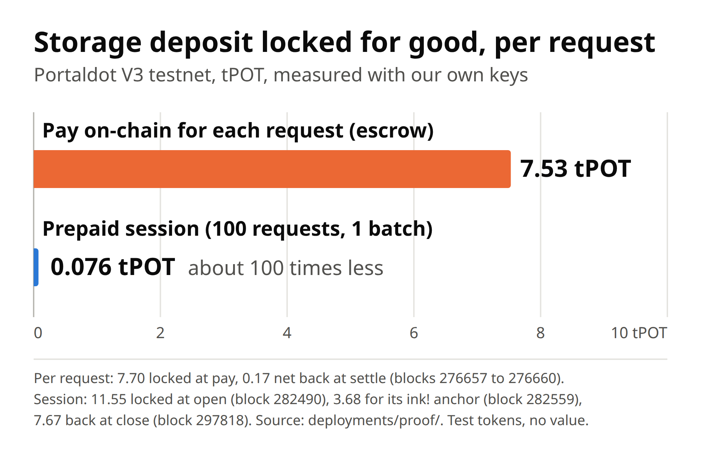

# Portal Meter

**Portal Meter sells any API per call on Portaldot V3. Paying on-chain for each request locked 7.53 tPOT of storage deposit
for good on this chain, so we built prepaid sessions: 100 requests locked about 7.6 tPOT in total and were settled in one
Ethereum transaction across Solidity and ink!.**



Measured on the PortaldotV3 testnet with our own keys. Per request: 7.70 tPOT locked at pay, 0.17 back at settle (blocks 276657
to 276660). Session of 100 requests: 11.55 locked at open (block 282490), 3.68 for its ink! anchor (block 282559), 7.67 back at
close (block 297818). Data: [`deployments/proof/session-measure.json`](deployments/proof/session-measure.json) and
[`deployments/testnet.json`](deployments/testnet.json). Test tokens have no value; the ratio is the point.

An API provider lists an endpoint with a price. A client pays per call in a Portaldot native asset, reached from Solidity
through the runtime's ERC-20 precompile. Money moves in a Solidity contract on Portaldot's EVM. In the same Ethereum-signed
transaction, the outcome lands in an **ink!** registry on Portaldot's WASM VM, which gives every provider a public record
that buyers can check before they pay. Two ways to pay share that design:

- **Prepaid session**, for high-frequency APIs. One budget, one signed voucher per request, no transaction per request. One
  Ethereum transaction settles many requests across both VMs. Each voucher commits to the hash of the previous response.
- **Per-request escrow**, for calls worth a few cents or more. Pay into escrow, served once, settled or refunded.

By Swift Bot Labs for the Portaldot Hacker House 2026, track **Modular Cloud & Middleware**.

**Live page:** [portal-meter.swiftbotlab.workers.dev/demo/](https://portal-meter.swiftbotlab.workers.dev/demo/) buys a real API
call from your browser with no wallet, reads both VMs directly, and includes a free receipt verifier.
**Hosted seller:** [portal-meter.swiftbotlab.workers.dev](https://portal-meter.swiftbotlab.workers.dev/) (a paid Portaldot
data API at 0.01 pUSD per call, on the testnet).
**Demo video (2:23):** [YouTube](https://youtu.be/sgGdQ-WLum0) or [MP4](https://portal-meter.swiftbotlab.workers.dev/demo/portal-meter-demo.mp4).
**Pitch deck:** [PDF](https://portal-meter.swiftbotlab.workers.dev/pitch/portal-meter-deck.pdf).
**Reuse:** [`examples/paid-indexer/`](examples/paid-indexer) installs the package in a folder of its own, sells a different API and settles
on the testnet, hosted at [paid-indexer.swiftbotlab.workers.dev](https://paid-indexer.swiftbotlab.workers.dev/) (endpoint 4); its run
log is [RUN.md](examples/paid-indexer/RUN.md).

## Check it in two minutes

1. Open the [live page](https://portal-meter.swiftbotlab.workers.dev/demo/) and press **Buy one request**. A public test key signs
   a voucher in your browser, the seller checks it and answers: HTTP 402, then 200, no wallet and no gas.
2. Press **Replay the session log against the chain**. It replays the public log, compares it with the signed head in the `Redeemed`
   event and reads the ink! anchor: ACCEPT, with every check listed.
3. Open the events of [block 282559](https://scanner-testnet-v3.portaldot.dev/#/blocks/282559?tab=events): one Ethereum
   transaction settled **137 requests from 3 sessions**. `revive.ContractEmitted`, `assets.Transferred`, `contracts.Called` and
   `utility.BatchCompleted` sit inside one extrinsic.
4. Ask for data without paying: `curl -i https://portal-meter.swiftbotlab.workers.dev/v1/asset/7777` answers 402 and a quote.
5. Try to cheat: `node scripts/negative-checks-sessions.mjs` sends bad vouchers to the live seller and dry-runs against the live
   contract, no key needed. 22 of 22 are refused.

## Five lines from a terminal

One paid call against the live seller, settled across both VMs, then checked against the chain:

```bash
npm i github:swiftbotlabs/portal-meter
curl -s https://portal-meter.swiftbotlab.workers.dev/v1/asset/7777
npx portal-meter session-open 3 --keys buyer.env --budget 0.25 --days 1 --out s.json
npx portal-meter session-buy https://portal-meter.swiftbotlab.workers.dev/v1/asset/7777 --session s.json
npx portal-meter session-verify https://portal-meter.swiftbotlab.workers.dev --session s.json
```

`buyer.env` is a `0600` file with one line, `PORTALDOT_EVM_BUYER_KEY=0x…`: a testnet EVM key holding about 12 tPOT and 0.25 pUSD
(asset 7777, from Portaldot's native exchange). The same package is mirrored on the hosted seller, in case GitHub is out of reach:
`npm i https://portal-meter.swiftbotlab.workers.dev/source/portal-meter-0.1.0.tgz`.

What we got, line by line, on 5 Nov 2026, with the package installed from an `npm pack` of this repository, which is what the mirror
serves. Here only, JSON bodies are condensed to one line, long hashes shortened, and line 5 shows its verdict line:

```text
npm WARN deprecated node-domexception@1.0.0: Use your platform's native DOMException instead
npm WARN deprecated @substrate/connect@0.8.11: versions below 1.x are no longer maintained
added 79 packages in 13s
{ "error": "payment required", "accepts": [ { … "provider": "0xE13A4d566A1f6492C1511EF100DC0417ccE18E59", "endpointId": 3, "tokenSymbol": "pUSD", "price": "10000", … } ] }
session 0xbf59f966153d082007c9a1b36c6361dc1365adc1522c71badc1c6d0f7f1778ab: budget 0.25, tx 0xc7dcc4a5…06c6, block 329592, state in s.json
· HTTP 200, request 1, spent 10000, head 0xebcfba2e…b065
{ "at": { "number": 329593, … }, "assetId": 7777, "name": "Portaldot USD (test)", "symbol": "pUSD", "decimals": 6, … }
NOT YET   1 request in the log, no batch on-chain yet: the seller settles on its own schedule, run this again later
```

We then asked the seller to settle now (`POST /admin/settle`, its owner's button; left alone, its cron settles a session about 6 hours
after its last request). One Ethereum transaction,
[block 329697](https://scanner-testnet-v3.portaldot.dev/#/blocks/329697?tab=events), carried the Solidity redeem and the ink!
anchor, and line 5 again:

```text
batch     up to request 1: 10000 paid, block 329697, tx 0x24aa5a1947432405911e0cd0bd2ce4f6e600901c6b2390eb91f5e8d89a18b770
PASS      log replays from the session genesis: 1 request
PASS      batch up to request 1 matches the payer-signed head on-chain (no response acknowledged yet): 0xebcfba2e…b065
PASS      ink! anchor of the batch up to request 1: endpoint, amount and receipt hash: block 329697, 10000 paid
ACCEPT    1 request in the log, 1 batch on-chain
```

Opening locked 11.55 tPOT of storage deposit and 0.25 pUSD. `npx portal-meter session-close --session s.json --keys buyer.env`
returns the unspent 0.24 pUSD and two thirds of that deposit (7.67 tPOT when we measured it) from 15 minutes after expiry.
Anyone can check that session without a key:
`npx portal-meter session-verify https://portal-meter.swiftbotlab.workers.dev --id 0xbf59f966153d082007c9a1b36c6361dc1365adc1522c71badc1c6d0f7f1778ab --provider 0xE13A4d566A1f6492C1511EF100DC0417ccE18E59 --endpoint 3`.

## What one request costs on-chain

Storage deposits decide this. We measured both paths on the testnet with our own keys (the numbers are in
[`deployments/proof/`](deployments/proof)). Test tokens have no value; the ratio is the point.

| | Per-request escrow | Prepaid session |
|---|---|---|
| Transactions per request | 2 | 0 |
| Locked for good per request | 7.53 tPOT | 0.076 tPOT in a 100-request session |
| 100 requests in total | about 753 tPOT | 7.6 tPOT |

Escrow numbers: blocks 276657 to 276660. Session numbers: 100 requests sent over HTTP to the hosted seller, no transaction per
request, then one batch. The session locks 11.55 tPOT at open, 7.67 of which comes back at close, and its batch locks one ink!
anchor, 3.68 tPOT. Each further batch of a session adds one more anchor. Settlement also runs unattended: the seller's cron sent
[block 282470](https://scanner-testnet-v3.portaldot.dev/#/blocks/282470?tab=events) by itself. Details: [docs/SESSIONS.md](docs/SESSIONS.md).

## Trust model

What each side can and cannot do to the other, and what enforces it. **Contract** means the deployed code: `MeterSession`
(`0xCc2aBc8A…`) and `MeterSettlement` (`0x9E7Ad2Aa…`) on the EVM, `MeterRegistry` in ink!. **Off-chain** means our seller,
client and verifier, which another seller could run differently.

### Prepaid session

A malicious seller **can**:

- take the price of one request and never answer it. The voucher for request n is signed before its response exists, so the
  seller always holds one unanswered voucher. `SessionClient` checks every receipt and stops signing at the first bad one
  (off-chain), so the loss is one price.
- serve wrong data. A redeemed head proves which bytes the client accepted, not that they were any good.
- change its payee or price, or pause the endpoint (`MeterSettlement.updateEndpoint`). `MeterSession` never reads the on-chain
  price: the client signs only quotes at or below its `--max` (off-chain). Redeem and close keep working on a paused endpoint.
- write any record it likes in its own ink! namespace, including one nobody paid for. `session-verify` checks that each
  anchor holds exactly the money of its `Redeemed` event (off-chain).

A malicious seller **cannot** (contract):

- take more than the session key signed. `redeem` pays only `cumulative - redeemed` of a voucher whose EIP-712 signature
  recovers to the session's signer (`BadSignature`), never above the deposit (`OverBudget`), and only a voucher newer in both
  amount and count (`NotNewer`).
- redeem a session of an endpoint it does not run: only that endpoint's provider may call `redeem` (`NotAllowed`).
- touch the unspent budget: only the payer may `close`.
- switch the token: no function changes an endpoint's token after registration.

A malicious buyer **can**:

- stop at any time. The seller holds a signed voucher for every request it has answered, so it risks only what it has not
  redeemed by the time the payer may close.
- open many small sessions so that the seller pays one ink! anchor deposit for each. The hosted seller refuses budgets under
  0.25 pUSD (off-chain).

A malicious buyer **cannot** (contract):

- close early: `close` reverts until 15 minutes after expiry (`TooEarly`, `CLOSE_GRACE`), which leaves the seller time to redeem.
- take back what was redeemed, reopen a closed session id or replay its vouchers. `close` keeps the session's first slot, so
  `open` reverts with `SessionExists` and `redeem` with `NoSession`.
- spend past its budget: the seller answers 402 before the handler runs (off-chain), and `redeem` would revert anyway.
- spend one step twice. On-chain only one voucher per count can ever be redeemed. Off-chain the seller serves one request per
  session at a time (409) and accepts only the voucher that extends its own chain.
- make the seller pay the session's storage: `open` writes all three slots from the payer's account, `redeem` writes none.
- pay with a token that delivers less than it says: `open` and `topUp` revert (`FeeOnTransfer`).

Disputes and refunds:

- There is no dispute transaction per request. A failed request charges nothing: the seller does not advance the session and
  the client signs the same step again. A lost response costs nothing: the same voucher gets the same body back (responses up to
  64 KB). Both are seller code, not contract rules.
- The refund is `close`. From 15 minutes after expiry the payer gets `deposit - redeemed` back, plus the storage deposit of two of
  the session's three slots (7.67 tPOT when we measured it).
- Timeouts: the payer picks the expiry at `open`, 10 minutes to 30 days ahead (contract). The hosted seller stops serving 30 minutes
  before expiry. It settles once 25 requests wait, 6 hours after a session's last request, or within an hour of a session's expiry when at
  least 0.05 pUSD of it is unredeemed (off-chain).
- `MeterRegistry.rate` (confirm or dispute) exists for per-request escrow payments only. In a session the buyer's recourse is to
  stop signing, close after expiry, and the public log, which anyone can replay against the signed head (`portal-meter session-verify`).

### Per-request escrow

- The buyer pays one request into escrow with a `maxPrice`. The request id is derived from the payer's address, so only that
  payer can reclaim or rate it.
- The provider can `settle` it once, to its payee, or `refund` it at any time. If it does neither, the payer can reclaim it after
  the endpoint's refund delay, 60 seconds to 7 days. The delay is read when the payer reclaims, so a provider can raise it, to 7
  days at most.
- A malicious provider can settle without serving: `settle` is its call alone. The buyer cannot get that money back on-chain. It
  can dispute in ink! with `rate(…, ok = false)`, which only the real payer can do and which lowers the provider's public score.

### Our own operations

- The hosted seller's provider key is a Cloudflare Worker secret. Whoever holds it can do what a malicious seller can, as listed
  above, and no more.

## Add it to your API

```bash
npm i github:swiftbotlabs/portal-meter
```

```js
import { createMeter, metered } from 'portal-meter';

const meter = createMeter({ chainId, sessionContract, endpointId, wallet, token, tokenSymbol, decimals, readSession });

// Express or anything with (req, res, next): the handler returns the body, the meter hashes and signs it
app.get('/v1/weather/:city', metered(meter, { price: 10_000n }, async req => forecast(req.params.city)));

// Cloudflare Workers, Bun, Deno, Hono: Web standard Request and Response
export default { fetch: req => meter.charge(req, { price: 10_000n }, () => forecast('oslo')) };
```

The core has no server of its own and needs no polkadot.js. [`worker/`](worker) is the real thing: the hosted seller in one file, with
a Durable Object as its ledger and a cron for settlement. `createSettler` from `portal-meter/settle` does the same settlement from any
ledger, on any runtime with `fetch`. [`examples/sell-an-api.mjs`](examples/sell-an-api.mjs) is a thirty-line paid API. Then:

```bash
node bin/portal-meter.mjs register --keys provider.env --asset 7777 --price 0.01 --payee 0x… --url https://you.example/v1/   # one tx, both VMs
node bin/portal-meter.mjs session-open 3 --keys buyer.env --budget 0.5 --out session.json    # lock a budget, get a capped session key
node bin/portal-meter.mjs session-buy https://portal-meter.swiftbotlab.workers.dev/v1/asset/7777 --session session.json
node bin/portal-meter.mjs set-url 3 --keys provider.env --url https://new.example/v1/        # moved hosts: the URL buyers find in ink!
node bin/portal-meter.mjs session-verify https://portal-meter.swiftbotlab.workers.dev --session session.json   # ACCEPT once settled, no key
```

Anyone can check a session against the chain with `portal-meter session-verify`, or `verifySellerSession` from `portal-meter/verify`:
the seller's public log, the payer-signed heads in the `Redeemed` events, and each batch's ink! anchor (endpoint, amount paid, receipt
hash). Before the first batch it answers NOT YET, never ACCEPT.

`pUSD` (asset 7777) is Portaldot's own test dollar: any builder can get it from the native exchange, so this works with real testnet
funds and no help from us.

### Reused from a folder of its own

[`examples/paid-indexer/`](examples/paid-indexer) is a second seller written the way a third party would write it: it depends on the
package only, uses only its public entry points (`portal-meter`, `/settle`, `/chain`, `/address`, `/session-client`), and sells a
different API, account transfer history from Portaldot's public explorer indexer, at 0.01 pUSD per call. It was installed from the
packed package in an empty folder and run on the testnet: endpoint 4 registered on both VMs in one transaction
([block 323203](https://scanner-testnet-v3.portaldot.dev/#/blocks/323203?tab=events)), a session opened, two paid calls, and the
seller's own settlement loop sent one Ethereum transaction with the Solidity redeem and the ink! anchor
([block 323215](https://scanner-testnet-v3.portaldot.dev/#/blocks/323215?tab=events)). The same app then moved to Cloudflare Workers,
[paid-indexer.swiftbotlab.workers.dev](https://paid-indexer.swiftbotlab.workers.dev/), and `portal-meter set-url` pointed endpoint 4's
ink! listing there ([block 327203](https://scanner-testnet-v3.portaldot.dev/#/blocks/327203?tab=events)). Five paid calls later its own
alarm settled them in one transaction ([block 327272](https://scanner-testnet-v3.portaldot.dev/#/blocks/327272?tab=events)), and
`node verify.mjs https://paid-indexer.swiftbotlab.workers.dev --id 0xd0a658f3…` checks that session against the chain: ACCEPT.
Every command and output: [`examples/paid-indexer/RUN.md`](examples/paid-indexer/RUN.md). The example is ours, not another team's.

> **Live on the PortaldotV3 testnet since 2026-11-01:** both payment contracts, the ink! registry, the hosted seller, and real
> requests settled in Solidity and anchored in ink! in one Ethereum transaction. See [Testnet deployment](#testnet-deployment).

## How a request is paid (escrow path)


1. `GET /v1/asset/7777` → `402 Payment Required` with a quote: endpoint, price, token, a fresh nonce, the hash of
   this exact request.
2. The client checks the quote against the on-chain endpoint and the provider's record in the ink! registry, then
   calls `MeterSettlement.pay(endpointId, nonce, maxPrice)`. The contract derives the request id from the payer's
   address, so the payment can never be claimed by anyone else.
3. The client retries with a proof signed by the paying key. The seller checks it and the on-chain payment, and
   claims the request id: **served once**.
4. The seller sends one Ethereum transaction to Portaldot's runtime pallets address with
   `utility.batchAll([revive.call(settle), contracts.call(record)])`: the Solidity settlement and the ink! anchor
   happen together or not at all. If it cannot deliver, the same transaction shape refunds instead.
5. The client gets the body and a provider-signed receipt. Anyone can verify it: **ACCEPT / REJECT** with every
   check, on the command line or in the browser.

Details: [docs/ARCHITECTURE.md](docs/ARCHITECTURE.md) · [docs/SESSIONS.md](docs/SESSIONS.md) · [docs/PROTOCOL.md](docs/PROTOCOL.md) ·
[SECURITY.md](SECURITY.md) · measured network facts in [docs/PORTALDOT_V3_NOTES.md](docs/PORTALDOT_V3_NOTES.md).

## Why Portaldot

| Portaldot V3 feature | What Portal Meter does with it |
|---|---|
| Native assets exposed to Solidity as ERC-20 (pallet-assets precompile) | endpoints are priced in a native asset (`tUSDm`); no wrapped token contract |
| Two contract VMs in one runtime (pallet-revive EVM + pallet-contracts WASM) | escrow in Solidity, provider registry in ink!, both keyed by the same EVM address |
| Runtime calls from Ethereum transactions (`revive.ethSubstrateCall`) | money and record in one atomic transaction signed by the provider's Ethereum key, many sessions per transaction; buyers rate providers in ink! from their Ethereum key |
| Storage deposits (pallet-revive / pallet-contracts) | measured per request, then designed around: sessions write nothing per request |
| Native exchange and pUSD (asset 7777) | the hosted seller is priced in Portaldot's own test dollar, which any builder can swap for on `pallet-asset-conversion` |

The ink! registry recomputes the Solidity request id (`keccak256(abi.encode(chainId, settlement, payer, endpoint,
nonce))`) from the caller's own address. Only the account that paid on the EVM side can rate a request, and no
bridge or oracle is involved.

## Testnet deployment

PortaldotV3 testnet: EVM chain id `420420777`, `https://test-evm-rpc-v3.portaldot.dev`,
`wss://test-node-v3.portaldot.dev`, explorer [scanner-testnet-v3.portaldot.dev](https://scanner-testnet-v3.portaldot.dev).

| | Address | Deployed in |
|---|---|---|
| `MeterSettlement` (Solidity, pallet-revive) | `0x9E7Ad2Aa754A0EBA70CFbd1db01d25ef97e5781e` | [block 276611](https://scanner-testnet-v3.portaldot.dev/#/blocks/276611?tab=events), tx `0x1adf1c422c9782a22d974dea3d2abc0be287da435747883e7895375d15731227` |
| `MeterRegistry` (ink!, pallet-contracts) | [`5DHgN8JZRpyo9mDaG1BSNh224AZXcQw8p3Y8GZK1K2Vd8Ku4`](https://scanner-testnet-v3.portaldot.dev/#/accounts/5DHgN8JZRpyo9mDaG1BSNh224AZXcQw8p3Y8GZK1K2Vd8Ku4) | [block 276655](https://scanner-testnet-v3.portaldot.dev/#/blocks/276655?tab=events), extrinsic `0xef17ab339d696959449ed2e94bd066fb86de2a1945297d0d3d7dc35f97bd60e0` |
| `MeterSession` (Solidity, pallet-revive) | `0xCc2aBc8AC1B5676e8f9678bb5B6881A0b743B3d5` | [block 282417](https://scanner-testnet-v3.portaldot.dev/#/blocks/282417?tab=events), tx `0xfa1c962f3796bdbb7e93d32110cc4d13ffac4dbe2e7c292280c98d075cbb6d2d` |
| Payment token, escrow path: native asset [#43907 tUSDm](https://scanner-testnet-v3.portaldot.dev/#/assets/43907) (test token, no value) | ERC-20 precompile `0x0000ab8300000000000000000000000000010000` | [block 276610](https://scanner-testnet-v3.portaldot.dev/#/blocks/276610?tab=events) |
| Payment token, sessions: native asset [#7777 pUSD](https://scanner-testnet-v3.portaldot.dev/#/assets/7777), Portaldot's own test dollar | ERC-20 precompile `0x00001e6100000000000000000000000000010000` | genesis of the test asset |

Every Solidity contract we deployed matches this repository byte for byte: `MeterSettlement`, `MeterSession` and the retired
first `MeterSession` (`0xeA6bf3B9...`, replaced after the security review, source in `contracts/evm-retired-v1/`).
Checked independently by [Bytematch](https://bytematch-portaldot.vercel.app/repo/swiftbotlabs/portal-meter), another Hacker
House team's source verifier, on 4 Nov 2026: 3 of 3 exact ([JSON](https://bytematch-portaldot.vercel.app/v1/repos/swiftbotlabs/portal-meter)).
Its scan also notes that its own compile of `contracts/evm-retired-v1` stopped at "Stack too deep": that contract only compiles
with `viaIR`, which the folder's `foundry.toml` sets. `forge build` there gives the deployed code exactly, once the one immutable
(the settlement address) is filled in.

| Step | Transaction | Block |
|---|---|---|
| Provider registers endpoint 1 (account view, 0.025 tUSDm) in Solidity | `0x44a7d0b4864bb4ea76649a1715401d3afde88ee56acffd64fb7600168bfdf39e` | [276612](https://scanner-testnet-v3.portaldot.dev/#/blocks/276612?tab=events) |
| Provider registers endpoint 2 (asset view, 0.010 tUSDm) in Solidity | `0xf4f367da4236935df37377c20356141798f4c34c7c8baf8c15ccd80cd6d45ba6` | [276613](https://scanner-testnet-v3.portaldot.dev/#/blocks/276613?tab=events) |
| Provider lists both endpoints in ink!, **one Ethereum tx** | `0x7c14d9debd223cc01974022bc64e05aa90f9bea08c36560aa4a6b012f6cc569b` | [276656](https://scanner-testnet-v3.portaldot.dev/#/blocks/276656?tab=events) |
| Buyer approves the settlement contract on the precompile | `0xca1867b45d46335dfe2c4b47254b4be6aff6cc01f3563897f99da7c55a68962b` | [276615](https://scanner-testnet-v3.portaldot.dev/#/blocks/276615?tab=events) |
| **Paid request:** buyer pays 0.025 tUSDm into escrow | `0x75b80a21c8b42251c6234a5dbbdecc2e8ae4e991ac2457268ac174dae28a7e8e` | [276657](https://scanner-testnet-v3.portaldot.dev/#/blocks/276657?tab=events) |
| **Served:** HTTP 200; settle in Solidity + anchor in ink!, **one Ethereum tx** | `0xf5264278d35ec75998992133da8fe8bc7bb8de5f7040137ba3353f1e7e0bacb6` | [276658](https://scanner-testnet-v3.portaldot.dev/#/blocks/276658?tab=events) |
| **Undeliverable request:** buyer pays 0.010 tUSDm for an asset that does not exist | `0xd511d2f40d3b05ae6e18bd61bf94c757c21d9e9a3eaad3dad0fffa6fc5984c86` | [276659](https://scanner-testnet-v3.portaldot.dev/#/blocks/276659?tab=events) |
| **Refunded:** HTTP 404; refund in Solidity + anchor in ink!, **one Ethereum tx** | `0x1a52029d1a3006600c7ad50c2424c18fefdf0df499505dd35e85c9d68a36f314` | [276660](https://scanner-testnet-v3.portaldot.dev/#/blocks/276660?tab=events) |
| **Buyer confirms** in ink! from its Ethereum key (the contract recomputes the Solidity request id) | `0x91d0a18a7aee958852e8f1903981a5c526910976c899c86192ef2f7970cd3297` | [276665](https://scanner-testnet-v3.portaldot.dev/#/blocks/276665?tab=events) |

Sessions, on the same testnet (everything in [`deployments/sessions.json`](deployments/sessions.json) and
[`deployments/proof/`](deployments/proof)):

| Step | Transaction | Block |
|---|---|---|
| Hosted provider registers endpoint 3 in Solidity and lists its public URL in ink!, **one Ethereum tx** | `0xeca4784ca0ba03ce7f110cbdc9af984dc2956f8d881edb5577261fcd7fd27b2c` | [282234](https://scanner-testnet-v3.portaldot.dev/#/blocks/282234?tab=events) |
| Buyer opens the public demo session | `0x083042840d18dc07bf182cc0160181ed918246f38b69cd9687835783bd488572` | [282419](https://scanner-testnet-v3.portaldot.dev/#/blocks/282419?tab=events) |
| **137 requests from 3 sessions settled**: redeem in Solidity + anchor in ink!, **one Ethereum tx**, signed in the Worker | `0xe5038746f42ed4f19ca896d7f80a0b04c3bf6335ca1f3e688e15dba1aded7f09` | [282559](https://scanner-testnet-v3.portaldot.dev/#/blocks/282559?tab=events) |
| Five lines from a terminal: a buyer opens a 0.25 pUSD session with the CLI | `0xc7dcc4a5cb08ef64b04d2874cb12119215afaeb8d89ed9d558a42bbc4dd706c6` | [329592](https://scanner-testnet-v3.portaldot.dev/#/blocks/329592?tab=events) |
| Its one paid request settled: redeem in Solidity + anchor in ink!, **one Ethereum tx** | `0x24aa5a1947432405911e0cd0bd2ce4f6e600901c6b2390eb91f5e8d89a18b770` | [329697](https://scanner-testnet-v3.portaldot.dev/#/blocks/329697?tab=events) |

`MeterSession` was deployed twice: an independent review before launch found problems that needed a contract change, so
`0xCc2aBc8A…` replaced `0xeA6bf3B9…`. The first deployment and its measurement are kept in `deployments/proof/`.

All requests so far come from our own measurement key and from visitors of the live page; none of this is a claim of user demand.

Both escrow receipts come back **ACCEPT** from the verifier, with the ink! anchor checked. Try it (no key needed):

```bash
node bin/portal-meter.mjs verify deployments/receipts/served.json
node bin/portal-meter.mjs status        # endpoints and provider record, read from the ink! contract
node scripts/negative-checks.mjs        # 14 dry-runs on the escrow path: replays, strangers and tampered receipts are refused
node scripts/negative-checks-sessions.mjs   # 22 checks on sessions: the live seller and dry-runs on the live contract
```

Everything is in [`deployments/testnet.json`](deployments/testnet.json). Signed receipts and verifier reports are in
[`deployments/receipts/`](deployments/receipts); receipts, events and the negative checks are archived in
[`deployments/proof/`](deployments/proof), because the public RPC prunes old transaction receipts. Earlier runs on the
same contract are kept too: `evm-*.json` (plain Solidity settlement) and `xvm-served.json` (settlement + a Substrate
remark in one Ethereum transaction), and `cli-*.json` from the commands below.

The explorer indexes the Substrate side, so open the block rather than searching for a `0x` hash. The events of
[block 276658](https://scanner-testnet-v3.portaldot.dev/#/blocks/276658?tab=events) show both VMs inside one extrinsic:
`assets.Transferred`, `revive.ContractEmitted`, `utility.ItemCompleted`, `contracts.ContractEmitted`, `contracts.Called`,
`utility.BatchCompleted`.
The escrow demo seller ran on `127.0.0.1` for those requests, and the URLs of endpoints 1 and 2 say so. Sessions use the
hosted seller, endpoint 3.

## Run it

Requirements: Node.js 20+, [Foundry](https://getfoundry.sh) for the contract tests.

```bash
npm ci --ignore-scripts
(cd contracts/evm && forge build && forge test)   # 42 Solidity tests: unit, fuzz, invariant
(cd contracts/ink/meter_registry && cargo test)   # 8 ink! unit tests (Rust, ink! 5.1.1), last run in CI on 1 Nov
npm test                                           # 73 Node tests, incl. end to end on a local anvil chain
node scripts/probe.mjs                             # re-checks the Portaldot facts this project relies on (read-only)
```

Against the testnet deployment (`deployments/testnet.json`):

```bash
node bin/portal-meter.mjs status                                   # endpoints and provider record, no key
node bin/portal-meter.mjs serve --keys provider.env                # the escrow seller on 127.0.0.1:8402
node bin/portal-meter.mjs buy http://127.0.0.1:8402/v1/asset/7777 --keys buyer.env --out receipt.json
node bin/portal-meter.mjs verify receipt.json                      # ACCEPT / REJECT, no key
```

Key files are `0600` env files (`PORTALDOT_EVM_PROVIDER_KEY=0x…`, `PORTALDOT_EVM_BUYER_KEY=0x…`), testnet keys only.

### Deploy your own

```bash
node scripts/keygen.mjs ~/portaldot_testnet.env          # sr25519 + three EVM keys, 0600, prints addresses only
# fund the printed sr25519 address with testnet tPOT (about 1,850), then:
node scripts/deploy-testnet.mjs --keys ~/portaldot_testnet.env --plan      # cost estimate, sends nothing
node scripts/deploy-testnet.mjs --keys ~/portaldot_testnet.env             # resumable, step by step
node scripts/deploy-testnet.mjs --keys ~/portaldot_testnet.env --no-ink    # EVM half only, about 400 tPOT
```

The ink! contract is built with `cargo contract build --release` (cargo-contract 5.0.3, also in the CI workflow); the bundle used for the
deployment is committed under `contracts/ink/meter_registry/artifact/`.

Sessions and the hosted seller:

```bash
node scripts/deploy-sessions.mjs --keys ~/portaldot_testnet.env --hosted ~/portaldot_hosted.env --plan    # then without --plan
# set SESSION_CONTRACT and ENDPOINT_ID in worker/wrangler.toml, then:
node scripts/build-site.mjs && node scripts/prerender-demo.mjs   # site files, and a static first paint of the live page
cd worker && npx wrangler@4.151.1 deploy
npx wrangler@4.151.1 secret put PROVIDER_KEY     # the hosted provider's testnet key, from stdin
```

## Repository

| Path | What |
|---|---|
| `contracts/evm/` | `MeterSettlement.sol`: endpoints, escrowed payments, settle once, refunds. `MeterSession.sol`: prepaid budgets, vouchers, redeem |
| `contracts/evm-retired-v1/` | source of the first `MeterSession` deployment, kept only so its on-chain code can be checked |
| `contracts/ink/meter_registry/` | `MeterRegistry` (ink! 5): endpoint URLs, outcome anchors, buyer feedback, reputation |
| `src/` | metering core (`meter.mjs`), session protocol and client, escrow seller and buyer, verifier, SCALE encoder without polkadot.js, EVM and ink! clients |
| `worker/` | the hosted seller on Cloudflare Workers |
| `examples/` | a paid API in thirty lines, and `paid-indexer/`: a separate consumer of the package (Node.js and Cloudflare Workers) with its testnet run log |
| `bin/portal-meter.mjs` | command line: `status`, `verify`, `buy`, `serve`, `register`, `set-url`, `session-open`, `session-buy`, `session-close`, `session-verify` |
| `scripts/` | key generation (testnet only), network probe, deployment + live demo, pitch deck builder |
| `test/` | Node tests, including end to end on a local anvil chain |
| `demo/` | the live page (static, served by the hosted seller) |
| `docs/` | architecture, sessions, protocol, Portaldot V3 network notes |
| `pitch/` | architecture diagram and pitch deck |

## What we don't claim

No users and no revenue: every request so far comes from our own keys and from visitors of the live page. Test tokens have no value.
The security review before launch was done by a reviewer who had not written the code, not by an audit firm. Nothing is on mainnet.

## Credits and prior work

- Builds on our MIT-licensed [HSK Meter](https://github.com/swiftbotlabs/hsk-meter) (Oct 2026, HashKey Chain, Python and
  Solidity). Reused as patterns, rewritten here in JavaScript and Solidity, no file copied: the x402-style headers
  (`PAYMENT-REQUIRED` / `PAYMENT-RESPONSE`, base64 JSON with size caps: HSK `server/protocol.py`, here `src/protocol.mjs`); a
  request id bound to its payer (HSK `compute_request_id` / `payer_of`, here `MeterSettlement.requestIdFor`, derived
  differently); a provider refund when a paid request cannot be served, and a request id used once (HSK
  `HskPayPerRequest.refund`, here `MeterSettlement.refund` and `settle`); the endpoint record with price and payee, and the
  contract's layout of endpoint and payment records; the escrow seller's quote, pay, retry-with-proof flow (HSK
  `server/seller.py`, here `src/seller.mjs`). New for Portaldot during the Hacker House: prepaid sessions (`MeterSession`,
  hash-chained vouchers, the meter, the session client), the ink! registry, cross-VM settlement in one Ethereum transaction
  and its SCALE encoder, the Cloudflare Worker seller, the settler, the verifier and the paid-indexer example.
- [taste-skill](https://github.com/Leonxlnx/taste-skill) (MIT, (c) 2026 Leonxlnx): the effect runtime behind the landing page's engraved hero plate, `site/assets/fx/` (`fx.js`, `line-engraving/`), with its LICENSE in that folder.
- [forge-std](https://github.com/foundry-rs/forge-std) v1.16.2 (MIT/Apache-2.0), vendored unmodified under
  `contracts/evm/lib/`, tests only. [ink!](https://github.com/use-ink/ink) 5.1.1 (Apache-2.0).
- [ethers](https://github.com/ethers-io/ethers.js) 6.16.0 (MIT), [polkadot.js](https://github.com/polkadot-js/api) 16.5.6
  (Apache-2.0) and [@noble/hashes](https://github.com/paulmillr/noble-hashes) 1.8.0 (MIT), pinned in `package-lock.json`; the
  browser bundle of ethers is vendored under `demo/vendor/`. The hosted seller runs on Cloudflare Workers.

## License

MIT, see [LICENSE](LICENSE).
