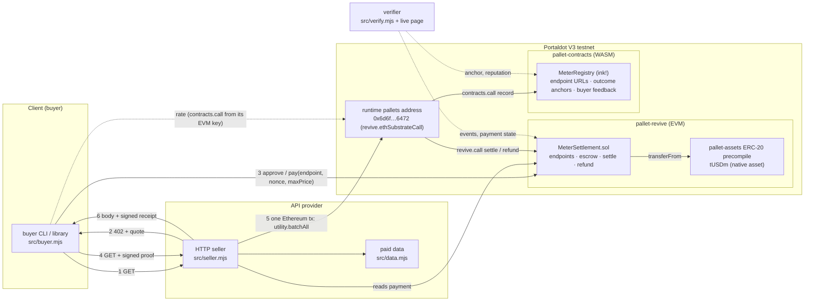

# Architecture

Portal Meter has two on-chain halves, one on each of Portaldot V3's contract VMs, and three off-chain programs.



## On-chain

### `MeterSettlement` (Solidity, pallet-revive)

- `registerEndpoint(payee, token, price, refundDelay)`: the caller becomes the endpoint's provider. The token must
  answer `totalSupply()`, which rules out addresses without code (a plain call to them would "succeed" without
  moving anything).
- `pay(endpointId, nonce, maxPrice)`: escrows `price` and derives
  `requestId = keccak256(abi.encode(chainId, this, msg.sender, endpointId, nonce))`. The id is bound to the payer,
  so nobody else can present the payment as theirs, and it can be used once, ever.
- `settle(requestId, responseHash)`: provider only, once: escrow goes to the payee, the response hash is logged.
- `refund(requestId, reason)`: the provider at any time; the payer after `refundDelay` if the provider did nothing.
- Storage is sized for pallet-revive's deposits: 3 slots per endpoint, 2 per payment, and the amount slot is
  zeroed when a payment is final so its deposit comes back.

### `MeterRegistry` (ink! 5, pallet-contracts)

- Namespaced by the caller's **EVM address**, computed with pallet-revive's own rule (`H160 ++ 0xEE*12` for
  Ethereum keys, `keccak256(account)[12..]` otherwise). A provider writes under the same address that owns its
  endpoints in `MeterSettlement`; nobody can write into someone else's namespace.
- `register_endpoint(id, uri)`, `set_uri`: the URL buyers use to find the endpoint.
- `record(endpoint, requestId, outcome, amount, receiptHash)`: anchors the outcome of a paid request once and
  updates the served / refunded counters and volume.
- `rate(provider, endpoint, nonce, ok)`: the payer confirms or disputes a served request. The contract recomputes
  the request id from the **caller's own address** and the nonce with the same keccak/ABI formula as Solidity, so
  only the account that paid on the EVM side can rate it, without any bridge, oracle or cross-VM read.
- `reputation(provider, endpoint)`: served, refunded, confirmed, disputed and a score in basis points.

## Cross-VM path

A Solidity contract on pallet-revive cannot call a pallet or an ink! contract (we checked: a call from a contract
to the runtime pallets address behaves like a call to an empty account). An **Ethereum transaction** can: when a
transaction is sent to `0x6d6f646c70792f70616464720000000000000000`, the runtime decodes its input as a SCALE-encoded
runtime call and dispatches it (`revive.ethSubstrateCall`) with the sender's twin account as a signed origin.

Portal Meter uses that for the provider's write path. One transaction, signed by the provider's Ethereum key:

```text
utility.batchAll([
  revive.call(MeterSettlement, settle(requestId, responseHash)),     // msg.sender = provider H160
  contracts.call(MeterRegistry, record(endpoint, requestId, 1, amount, receiptHash)),
])
```

`batchAll` is all-or-nothing: either the Solidity settlement and the ink! anchor both happen, or neither does.
On chain this is one `revive.ethTransact` extrinsic whose events come from both VMs, for example
[block 276658](https://scanner-testnet-v3.portaldot.dev/#/blocks/276658?tab=events): `assets.Transferred`,
`revive.ContractEmitted`, `utility.ItemCompleted`, `contracts.ContractEmitted`, `contracts.Called`,
`utility.BatchCompleted`.
The same path lists endpoints in the registry and lets the buyer's Ethereum key call `rate` on the ink! contract.
All of this ran on the testnet: see the transactions in the [README](../README.md#testnet-deployment). `eth_getLogs`
returns the `Served` and `Refunded` events of these runtime-dispatched calls under the Ethereum transaction's hash, so
the verifier treats them like any other settlement.

The fallback when the cross-VM path is not wanted is `EvmSettler`: plain Solidity calls, no anchor.

## Off-chain

| Program | Role |
|---|---|
| `src/seller.mjs` | HTTP 402 seller: quotes, checks the payment proof and the on-chain payment, serves once, settles or refunds, signs the receipt |
| `src/data.mjs` | the paid data: a cross-VM view of Portaldot accounts and native assets (both VMs read and compared) |
| `src/buyer.mjs` | client: checks the quote, the on-chain endpoint and the provider's ink! record before paying, then pays and retries |
| `src/verify.mjs` | receipt verifier: ACCEPT / REJECT with every check, in Node and in the browser |
| `src/inkraw.mjs` | dependency-free ink! read client (SCALE over `state_call`), used by the live page |
| `scripts/deploy-testnet.mjs` | resumable deployment and live demo |

See [PROTOCOL.md](PROTOCOL.md) for the wire format and [../SECURITY.md](../SECURITY.md) for the threat model.
